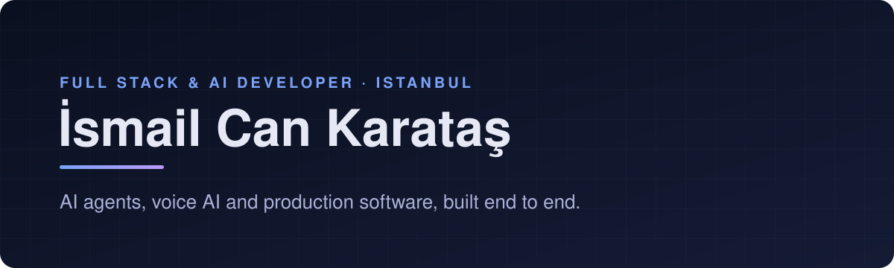

  

  <a href="https://ismailcankaratas.com.tr"><b>Website</b></a> &nbsp; / &nbsp;
  <a href="https://www.linkedin.com/in/ismailcankaratas/"><b>LinkedIn</b></a> &nbsp; / &nbsp;
  <a href="https://x.com/ismailcankarats"><b>X</b></a> &nbsp; / &nbsp;
  <a href="https://medium.com/@ismailcankaratas"><b>Medium</b></a> &nbsp; / &nbsp;
  <a href="mailto:ismailcankaratasss@gmail.com"><b>Get in touch</b></a>

 

I’m **İsmail Can**, a full stack & AI developer from Istanbul. I build AI agents, voice AI and enterprise software, and take them from idea to production.

Before going independent I built ERP modules, marketplace integrations and a RAG-based ERP assistant at Proentegre, and hospital software with FHIR integrations before that. Here you can explore the open-source tools that came out of that work.

## Start here

<table>
  <tr>
    <td width="50%" valign="top">
      01 / AGENTS
      <h3><a href="https://github.com/ismailcankaratas/opus-orchestrator">Opus Orchestrator</a></h3>
      
An Opus-led multi-agent workflow for Claude Code. Plan, delegate, implement, test and review with specialized agents.

      
<a href="https://github.com/ismailcankaratas/opus-orchestrator"><b>Run the fleet →</b></a>

    </td>
    <td width="50%" valign="top">
      02 / OBSERVABILITY
      <h3><a href="https://github.com/ismailcankaratas/orbit">Orbit</a></h3>
      
Local-first observability for Claude Code: projects, sessions, tokens and estimated API value. Nothing leaves your machine.

      
<a href="https://github.com/ismailcankaratas/orbit"><b>See where the tokens go →</b></a>

    </td>
  </tr>
  <tr>
    <td width="50%" valign="top">
      03 / SAAS
      <h3><a href="https://github.com/ismailcankaratas/saas-multi-tenant-starter">Multi-Tenant SaaS Starter</a></h3>
      
A full-stack multi-tenant starter kit with authentication, roles, permissions and a clean UI.

      
<a href="https://github.com/ismailcankaratas/saas-multi-tenant-starter"><b>Start your SaaS →</b></a>

    </td>
    <td width="50%" valign="top">
      04 / RAG
      <h3><a href="https://github.com/ismailcankaratas/rag-example">RAG with Qdrant</a></h3>
      
A compact example of retrieval-augmented generation on top of the Qdrant vector database.

      
<a href="https://github.com/ismailcankaratas/rag-example"><b>Read the pipeline →</b></a>

    </td>
  </tr>
</table>

## On the workbench: Lethiring

**AI-powered hiring for teams that recruit at scale.**

I’m building Lethiring to cut the busywork out of hiring: CV parsing, candidate–job match scoring, interview questions and job posts. The newest piece is an **AI voice phone line** that answers candidates who call, asks the screening questions and hands the hiring manager a ready shortlist.

**In active development.** The codebase is private.

[Visit Lethiring](https://lethiring.com)

## A few more to open

| Project | What to look for |
| :--- | :--- |
| [mcp-mssql](https://github.com/ismailcankaratas/mcp-mssql) | An MCP server that lets Claude query MSSQL safely, from natural language to SQL. |
| [lmwebui](https://github.com/ismailcankaratas/lmwebui) | A privacy-focused web UI for local Ollama models. |
| [desk-robot](https://github.com/ismailcankaratas/desk-robot) | A local voice robot on Raspberry Pi: speech → Ollama → spoken reply. |
| [voice-assistant](https://github.com/ismailcankaratas/voice-assistant) | A natural-language voice assistant with OpenAI and Python. |
| [dbcopycat](https://github.com/ismailcankaratas/dbcopycat) | A file-based JSON database with simple CRUD. |

<b>Stack</b>

 

`TypeScript` · `Node.js` · `Python` · `Next.js` · `React` · `React Native` · `Tailwind CSS` 
`OpenAI` · `Claude` · `MCP` · `RAG` · `Voice AI` 
`PostgreSQL` · `Prisma` · `MSSQL` · `MongoDB` · `Redis` · `Qdrant` · `Docker` · `Vercel`

 

---

  <b>Build. Ship. Integrate. Repeat.</b> 
  For freelance work and collaborations: <a href="mailto:ismailcankaratasss@gmail.com">ismailcankaratasss@gmail.com</a>

